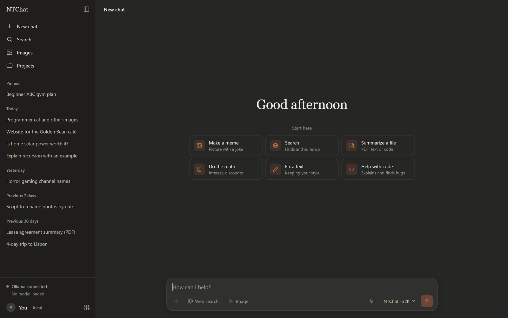
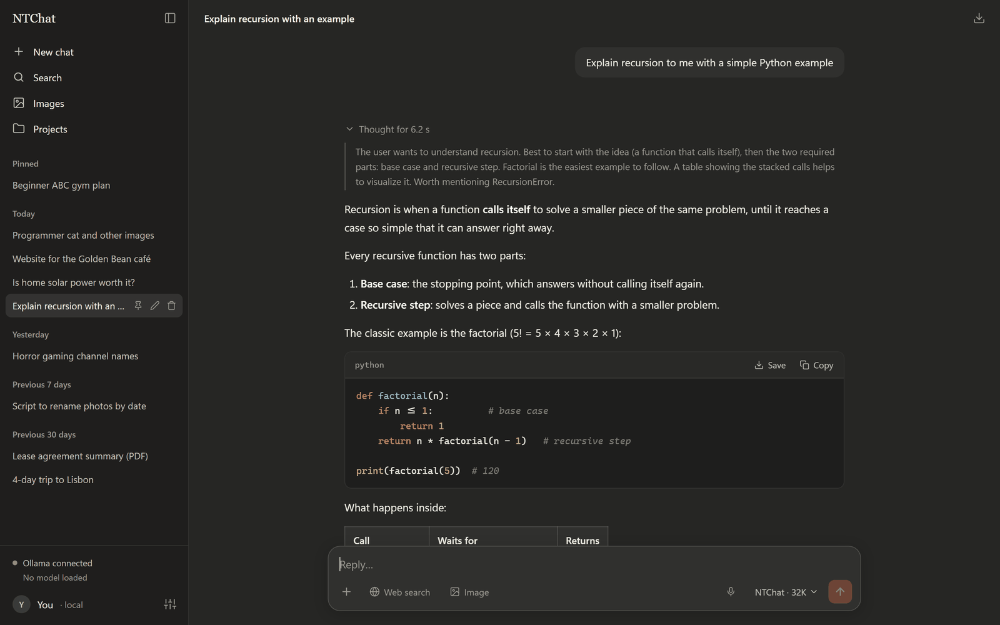
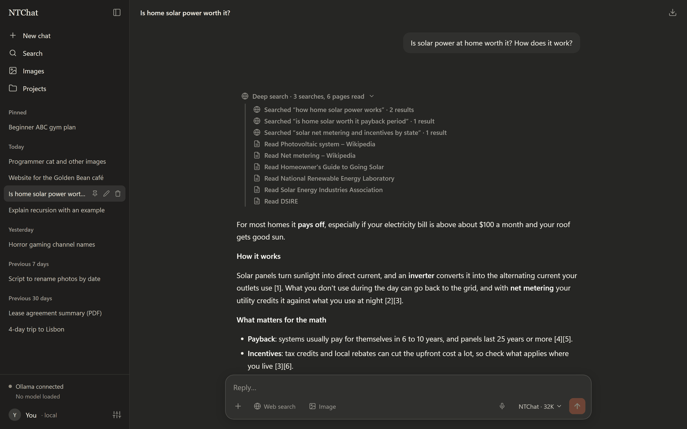
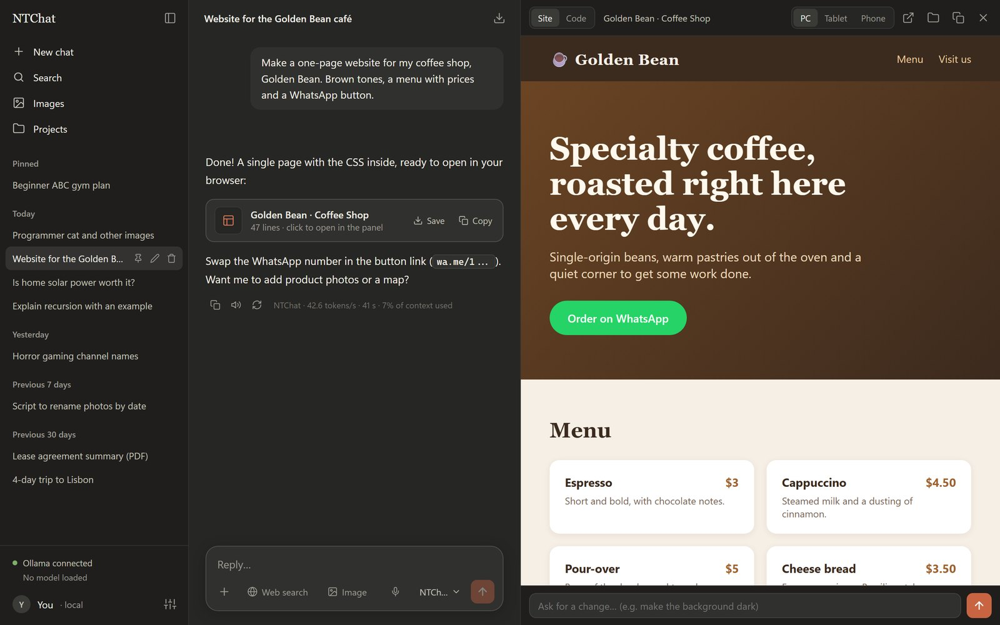
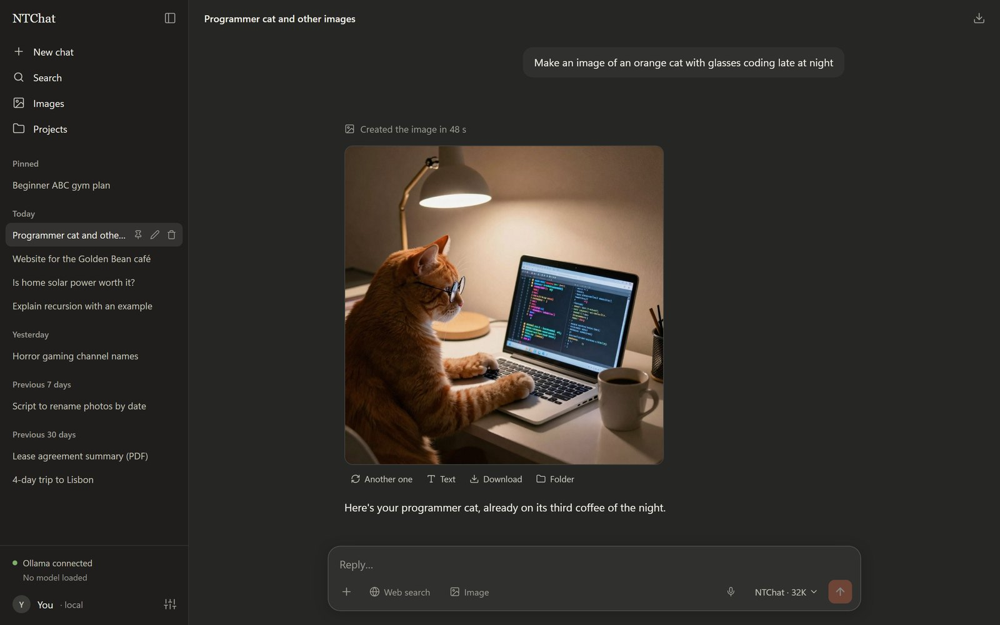
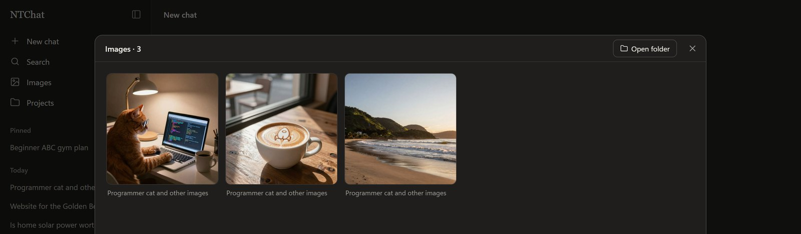
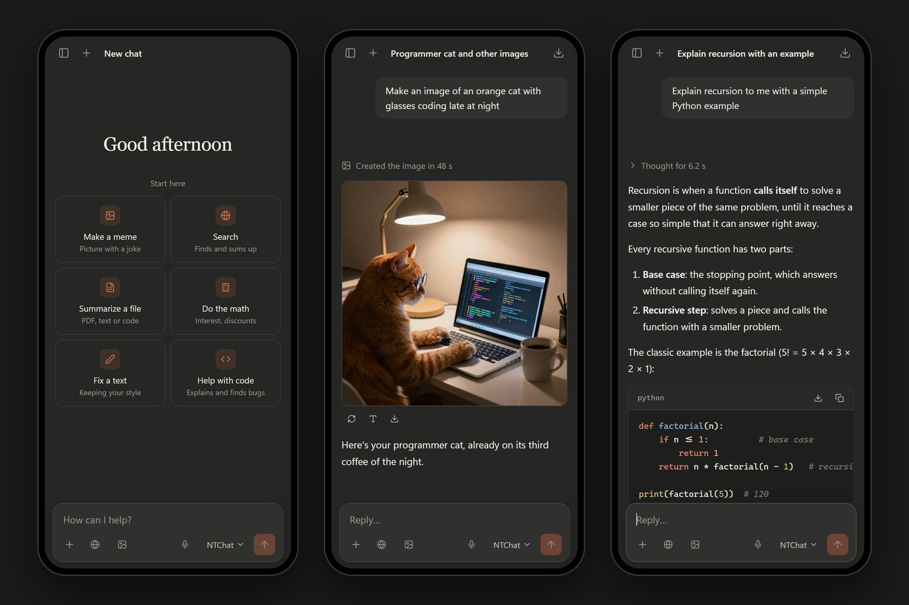
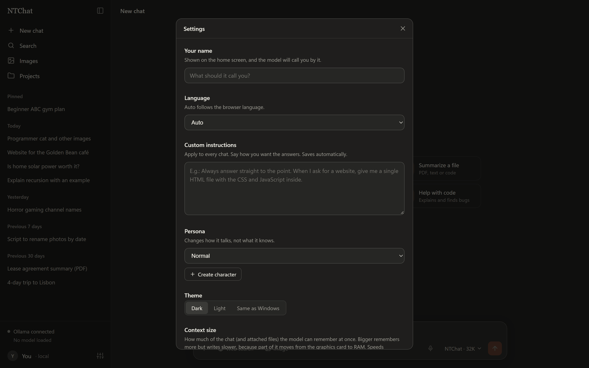
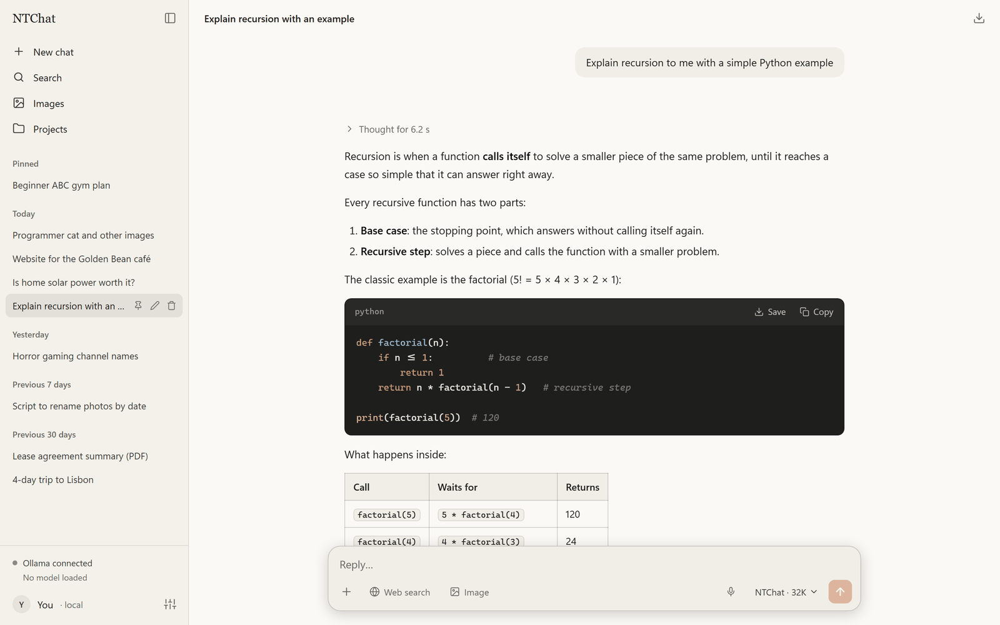

# NTChat

[Português](README.pt-BR.md) · **English**

A ChatGPT-style AI assistant that runs **entirely on your PC**: uncensored, no subscription, and your chats never go to any company. It chats, thinks before answering, searches the web, builds websites and images, reads photos and PDFs, and also works on your phone over your home Wi-Fi.

### [⬇ Download NTChat for Windows](https://github.com/inflzzz/NTChat/releases/latest/download/NTChat.zip)

Then just extract it and double-click `instalar.bat`. Every version is in [Releases](https://github.com/inflzzz/NTChat/releases).

## Installation

1. [Download NTChat.zip](https://github.com/inflzzz/NTChat/releases/latest/download/NTChat.zip) and extract it to a folder (ideally on an SSD, e.g. `C:\NTChat`).
2. Open the **NTChat** folder and double-click **`instalar.bat`**.
3. Pick which image models you want (or none), say whether it should start with Windows, and wait. At the end it creates a **NTChat** shortcut on your desktop and opens the app.

The installer downloads and sets up everything by itself, no administrator needed:

| What | For | Disk space |
|---|---|---|
| Its own Python (lives inside the app folder) | chat server, voice and stickers | ~0.6 GB |
| [Ollama](https://ollama.com) | runs the AI model | ~3 GB |
| **NTChat** model (uncensored, understands images) | the brain of the chat | ~6 GB |
| [ComfyUI](https://github.com/Comfy-Org/ComfyUI) (if you pick any image model) | runs the image models | ~6 GB |
| Chroma1-HD (optional) | uncensored, the most detailed images | 15 to 23 GB |
| Z-Image Turbo (optional) | fast images, great at photos | 10 to 20 GB |
| Stable Diffusion 1.5 (optional) | instant images, with a wonky old-AI look | 2.3 GB |

About 10 GB without images. You pick the image models from a menu during installation, and later you can install or remove each one in **Settings → Image models**, without running the installer again.

You can run `instalar.bat` again any time: it skips what is already installed and resumes interrupted downloads. If you open the shortcut before installing, the installer opens by itself. The installer and the app speak English or Portuguese, following your Windows and browser language.

> Windows may show "Windows protected your PC" the first time, because the file came from the internet. Click **More info → Run anyway**.

### What your PC needs

- Windows 10 or 11, 64-bit
- 16 GB of RAM (8 GB works, but it gets slow)
- A graphics card with 8 GB or more to be fast. Without one, the chat runs on the processor, just much slower.

| Graphics card | Chat | Images |
|---|---|---|
| NVIDIA RTX 50 | ✅ | ✅ fastest version (nvfp4) |
| NVIDIA GTX 16, RTX 20, 30 and 40 | ✅ | ✅ |
| AMD Radeon RX 6000, 7000 and 9000 (Windows 11) | ✅ | ✅ (not tested yet) |
| Intel Arc | ✅ | ✅ (not tested yet) |
| NVIDIA GTX 10 and older, integrated or older AMD | ✅ | ❌ |
| No graphics card | ✅ on the processor (slow) | ❌ |

The installer finds out which card you have and downloads the right version.

## What it does

### Thinks before answering

On Auto it only thinks when the question needs it (code, math, logic, big files) and answers small talk right away. Click "Thought for…" to see the reasoning.

### Searches the web

Turn on **Web search** and pick:

- **Quick**: it searches and opens the pages it thinks it needs.
- **Deep**: it plans several searches, reads up to 8 pages and answers citing the sources as [1], [2]…

### Builds websites

Ask for a website and it shows up ready next to the chat. You can see how it looks on a computer, tablet and phone, ask for changes ("make the background dark"), edit the code and save it with one click to your Documents folder.

### Creates images

Turn on **Image** and ask for anything: a photo, a meme, a drawing. Pick the model next to the style:

- **Chroma** (default): uncensored and the most detailed; takes about 2 minutes per image.
- **Z-Image Turbo**: fast (about 10 seconds) and great at realistic photos.
- **Stable Diffusion 1.5**: the 2022 model. Comes out in seconds, with that wonky, funny look of the old AIs.

Also pick the style (realistic photo, cartoon, anime, 3D animation, pixel art, oil painting, Lego) and how many images. Then you can:

- make **another one**;
- **edit** it ("put a hat on him");
- make a more detailed **2K** version;
- add **meme text** at the top and bottom;
- turn it into a **sticker** (cuts out the background, ready for WhatsApp).

Every image goes to the gallery and to a folder in your Documents.

### Works on your phone

With the PC on, open **Settings → Use on your phone**: you get an address and a 6-digit code. Open the address in your phone's browser (on the same Wi-Fi), type the code and you're in. Chats, memory and projects are the same on the PC and the phone. Use **Add to Home screen** to open it like an app.

### Remembers you

It saves what you tell it about yourself on its own (you can see and delete each item in Settings). You can also write instructions for every chat, pick a persona (pirate, patient teacher, soccer commentator…) or **create your own** by writing how it talks and behaves, and choose how much of the chat it remembers.

### And more

- **Attach images, PDFs and code files**: it reads them and answers about them.
- **Voice typing**: talk and it types (runs on the PC, nothing goes to the internet).
- **Listen** to answers read aloud.
- **Long chats** don't "forget" the start: when memory fills up, it summarizes the old messages by itself.
- **Math done right**: for any calculation it uses a real calculator instead of doing it in its head.
- **Searches by itself when needed**: even with Web search off, it looks things up when the question needs something current (exchange rates, news, results) instead of making it up. You can turn this off in Settings → Automatic search.
- **Quick to answer**: the model starts loading while you type and stays ready while NTChat is on screen. About 10 minutes after you leave, it frees the graphics card by itself (or right away with the **Free up** button in the sidebar, before playing a game for example).
- **Projects**: group chats with their own instructions and files.
- Edit a message and resend it, regenerate an answer, continue an answer that got cut off.
- Pin, rename, search and export chats.
- Dark, light or same-as-Windows theme.
- **English or Portuguese**: follows the browser language, or pick it in Settings → Language.
- **Updates itself** when a new version comes out (see below).

## Privacy

- Everything runs on your PC: the model, the images, the voice. Your chats stay in the app's `dados` folder.
- The internet is only used when you turn on **Web search**, during installation (to download things) and to check GitHub for updates.
- The phone only connects over your home network, with the 6-digit code. Changing the code disconnects every device.

## FAQ

**How do I update?** You don't have to: every 6 hours NTChat checks [Releases](https://github.com/inflzzz/NTChat/releases) for a new version. When there is one, it downloads it and installs it as soon as you stop using it for a few minutes, and the page reloads by itself. Your chats (`dados`) and your settings (`config.json`) are not touched. In Settings → Updates you can turn this off or update right away.

**Can I use another model?** Yes. Download any model with Ollama (`ollama pull model-name`) and change `model` in the app folder's `config.json`. `model_name` is the name shown on screen.

**The first image is slow.** That's normal: the first time, it loads the image generator onto the graphics card (about 50 seconds to a minute and a half). With **Image** on, it starts the generator while you type. The next ones come out much faster.

**The microphone doesn't show up on my phone.** Browsers only allow the microphone on HTTPS sites, and NTChat on the phone uses your home network without HTTPS. It works normally on the PC.

**How do I uninstall?** Delete the app folder and the "NTChat" shortcuts. To remove the model, run `ollama rm ntchat`. Ollama uninstalls from Windows' Installed apps.

## Warning

The default model is **uncensored**: it answers about anything. You are responsible for what you ask and for what you do with the answers.

## Improving the translation

The app is written in Portuguese, and `i18n.js` holds the English version of every text. To fix or improve the English, edit the right-hand side of that file.

## Credits

- [Ollama](https://ollama.com) runs the text model.
- Model: [DeepSeek-V4-Pro-Qwen3.5-9B-UNCENSORED-heretic](https://huggingface.co/mradermacher/DeepSeek-V4-Pro-Qwen3.5-9B-UNCENSORED-heretic-i1-GGUF), GGUF version by mradermacher.
- [ComfyUI](https://github.com/Comfy-Org/ComfyUI) runs the image models: [Chroma1-HD](https://huggingface.co/lodestones/Chroma1-HD), [Z-Image Turbo](https://huggingface.co/Comfy-Org/z_image_turbo) and [Stable Diffusion 1.5](https://huggingface.co/stable-diffusion-v1-5/stable-diffusion-v1-5) with [LCM-LoRA](https://huggingface.co/latent-consistency/lcm-lora-sdv1-5). [Real-ESRGAN](https://github.com/xinntao/Real-ESRGAN) makes the 2K version.
- [faster-whisper](https://github.com/SYSTRAN/faster-whisper) does voice typing and [rembg](https://github.com/danielgatis/rembg) cuts out the stickers.
- In the `lib` folder: [marked](https://github.com/markedjs/marked) (MIT), [highlight.js](https://github.com/highlightjs/highlight.js) (BSD-3), [DOMPurify](https://github.com/cure53/DOMPurify) (Apache 2.0 / MPL 2.0) and [pdf.js](https://github.com/mozilla/pdf.js) (Apache 2.0).

Each model has its own license; check each one's page before commercial use.

## License

[MIT](LICENSE)
