# NTChat

**Português** · [English](README.md)

Um assistente de IA no estilo ChatGPT que roda **inteiro no seu PC**: sem censura, sem mensalidade e sem mandar suas conversas pra nenhuma empresa. Conversa, pensa antes de responder, pesquisa na internet, cria sites e imagens, **edita as suas fotos**, **conversa por voz**, entende fotos e PDFs, e funciona também no celular pelo Wi-Fi de casa.

### [⬇ Baixar o NTChat para Windows](https://github.com/inflzzz/NTChat/releases/latest/download/NTChat.zip)

Depois é só extrair e dar dois cliques em `instalar.bat`. Todas as versões ficam em [Releases](https://github.com/inflzzz/NTChat/releases).

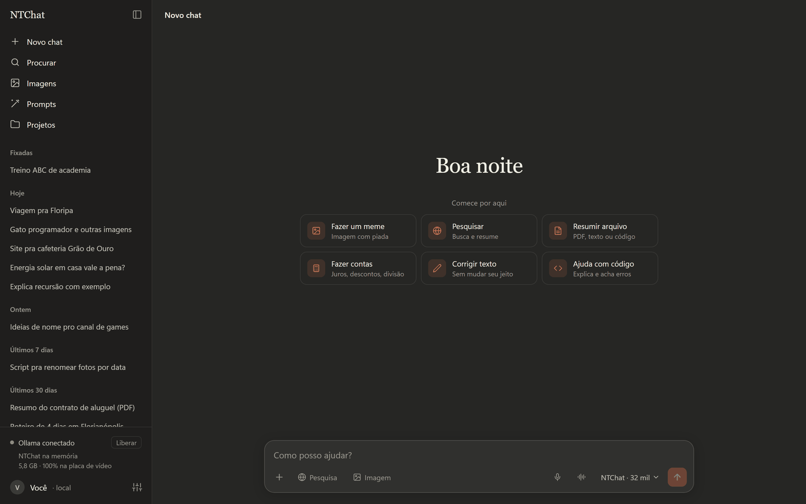

## Instalação

1. [Baixe o NTChat.zip](https://github.com/inflzzz/NTChat/releases/latest/download/NTChat.zip) e extraia numa pasta (de preferência no SSD, ex.: `C:\NTChat`).
2. Abra a pasta **NTChat** e dê dois cliques em **`instalar.bat`**.
3. Escolha o que instalar além do chat (Enter instala os recomendados, marcados com ✓), diga se ele deve ligar junto com o Windows e espere. No fim ele cria o atalho **NTChat** na área de trabalho e abre o app, com um tour rápido das funções.

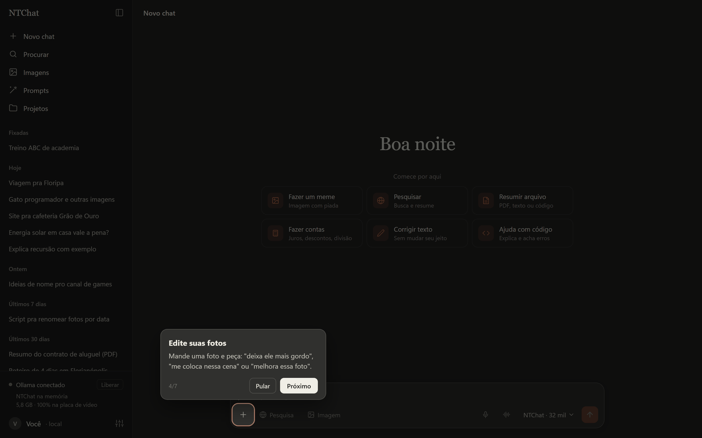

O instalador baixa e configura tudo sozinho, sem precisar de administrador:

| O quê | Pra quê | Espaço no disco |
|---|---|---|
| Python próprio (fica dentro da pasta do app) | servidor do chat | ~0,1 GB |
| [Ollama](https://ollama.com) | roda o modelo de IA | ~3 GB |
| Modelo **NTChat** (sem censura, entende imagens) | o cérebro do chat | ~6 GB |
| Voz do NTChat ✓ (opcional) | lê as respostas e conversa por voz | 0,2 GB |
| Microfone ✓ (opcional) | fala em vez de digitar | 0,6 GB |
| Figurinhas (opcional) | recorta o fundo das imagens | 0,4 GB |
| [ComfyUI](https://github.com/Comfy-Org/ComfyUI) (se escolher algum modelo de imagem) | roda os modelos de imagem | ~6 GB |
| Chroma1-HD (opcional) | imagens sem censura e as mais detalhadas | 15 a 23 GB |
| Z-Image Turbo ✓ (opcional) | imagens rápidas, ótimo em foto | 10 a 20 GB |
| Stable Diffusion 1.5 (opcional) | imagens instantâneas, com visual torto de IA antiga | 2,3 GB |
| FLUX.2 klein ✓ (opcional) | edita as fotos que você manda | 4,4 a 12 GB |

✓ = recomendado. Só o chat são uns 10 GB. Tudo que é opcional aparece num menu só na instalação; as partes de voz rodam no processador, então funcionam em qualquer PC. Depois dá pra instalar ou remover cada modelo de imagem em **Configurações → Modelos de imagem**, sem rodar o instalador de novo, e pra pôr voz, microfone ou figurinhas é só rodar o instalador de novo.

Pode rodar o `instalar.bat` de novo quando quiser: ele pula o que já está instalado e continua downloads que foram interrompidos. Se você abrir o atalho antes de instalar, o instalador abre sozinho.

> O Windows pode mostrar "O Windows protegeu o computador" na primeira vez, porque o arquivo veio da internet. Clique em **Mais informações → Executar assim mesmo**.

### O que precisa no PC

- Windows 10 ou 11, 64 bits
- 16 GB de RAM (8 GB funciona, mas fica lento)
- Placa de vídeo com 8 GB ou mais pra ficar rápido. Sem placa o chat roda no processador, só que bem mais devagar.

| Placa de vídeo | Chat | Imagens |
|---|---|---|
| NVIDIA RTX 50 | ✅ | ✅ versão mais rápida (nvfp4) |
| NVIDIA GTX 16, RTX 20, 30 e 40 | ✅ | ✅ |
| AMD Radeon RX 6000, 7000 e 9000 (Windows 11) | ✅ | ✅ (ainda não testado) |
| Intel Arc | ✅ | ✅ (ainda não testado) |
| NVIDIA GTX 10 e mais antigas, AMD integrada ou mais antiga | ✅ | ❌ |
| Sem placa de vídeo | ✅ no processador (lento) | ❌ |

O instalador descobre sozinho qual é a sua placa e baixa a versão certa.

## O que ele faz

### Pensa antes de responder

No modo automático ele só pensa quando a pergunta pede (código, contas, lógica, arquivos grandes) e responde direto no papo simples. Dá pra ver o raciocínio clicando em "Pensou por…".

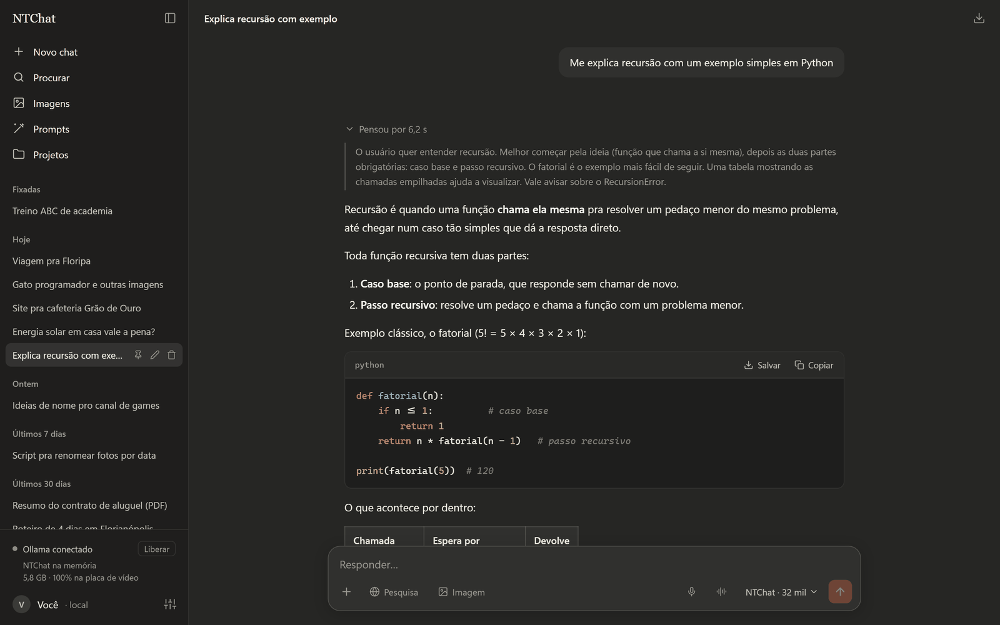

### Pesquisa na internet

Ligue **Pesquisa** e escolha:

- **Rápida**: ele busca e abre as páginas que achar necessárias.
- **Profunda**: ele planeja várias buscas, lê até 8 páginas e responde citando as fontes com [1], [2]…

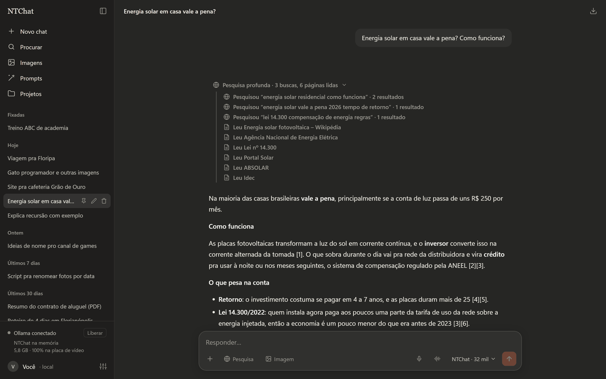

### Cria sites

Peça um site e ele aparece pronto ao lado da conversa. Dá pra ver como fica no PC, tablet e celular, pedir mudanças ("deixa o fundo escuro"), editar o código e salvar com um clique em `Documentos\Sites do Chat`.

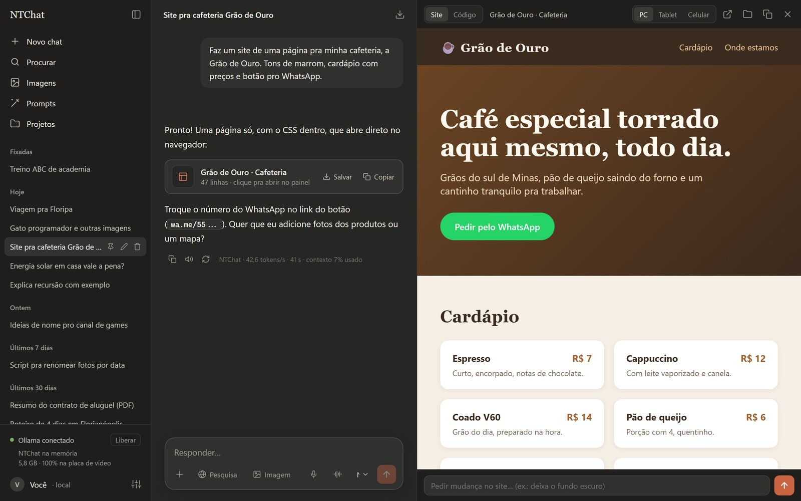

### Cria imagens

Ligue **Imagem** e peça qualquer coisa: foto, meme, desenho. Escolha o modelo do lado do estilo:

- **Chroma**: sem censura e o mais detalhado; leva uns 2 minutos por imagem.
- **Z-Image Turbo**: rápido (uns 10 segundos) e ótimo em foto realista.
- **Stable Diffusion 1.5**: o modelo de 2022. Sai em segundos, com aquele visual torto e engraçado das IAs antigas.

Escolha também o estilo (foto realista, desenho animado, anime, animação 3D, pixel art, pintura a óleo, Lego) e quantas imagens. Depois dá pra:

- gerar **outra versão**;
- **editar** ("coloca um chapéu nele");
- fazer uma versão **2K** com mais detalhe;
- colocar **texto de meme** em cima e embaixo;
- transformar em **figurinha** (recorta o fundo, pronta pro WhatsApp).

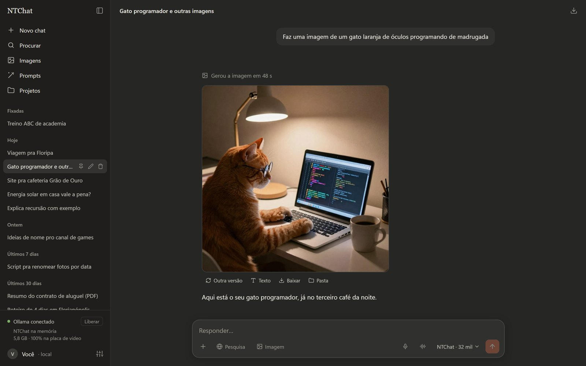

Todas as imagens ficam na galeria e em `Documentos\Imagens do Chat`.

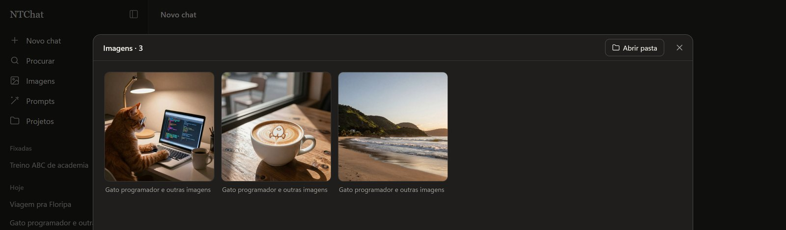

### Edita as suas fotos

Mande uma foto com **Imagem** ligado e peça a mudança do seu jeito, em português. O resto da foto continua igual. Quem edita é o FLUX.2 klein, e cada edição leva uns 10 segundos.

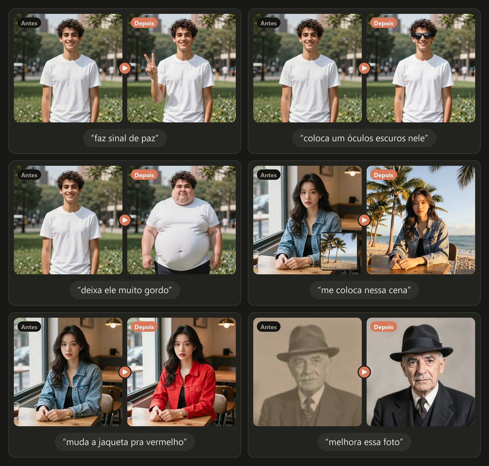

- **Gestos, roupa e acessórios**: "faz sinal de paz", "muda a jaqueta pra vermelho", "coloca um óculos escuros nele".
- **Corpo**: "deixa ele muito gordo", "mais gordo ainda", "deixa ele magro".
- **Montagem**: mande a sua foto e a de um lugar e peça "me coloca nessa cena", ou a foto de um logo e "coloca isso na camisa".
- **Melhorar**: "melhora essa foto" deixa nítida uma foto pequena, borrada ou antiga.
- Cada pedido continua da última versão, então dá pra ir ajustando aos poucos.

As fotos dos exemplos foram criadas no próprio NTChat (Z-Image) e editadas com pedidos curtos como os de cima. Ninguém nelas existe de verdade.

### Conversa por voz

Clique no botão de ondinhas ao lado do microfone e converse falando: ele ouve, responde curto, fala a resposta e volta a ouvir. A voz é a do **Kokoro** (escolha entre Santa, Dora e Alex em Configurações) e roda no processador, sem ocupar a placa de vídeo. O botão **Ouvir** das respostas usa a mesma voz.

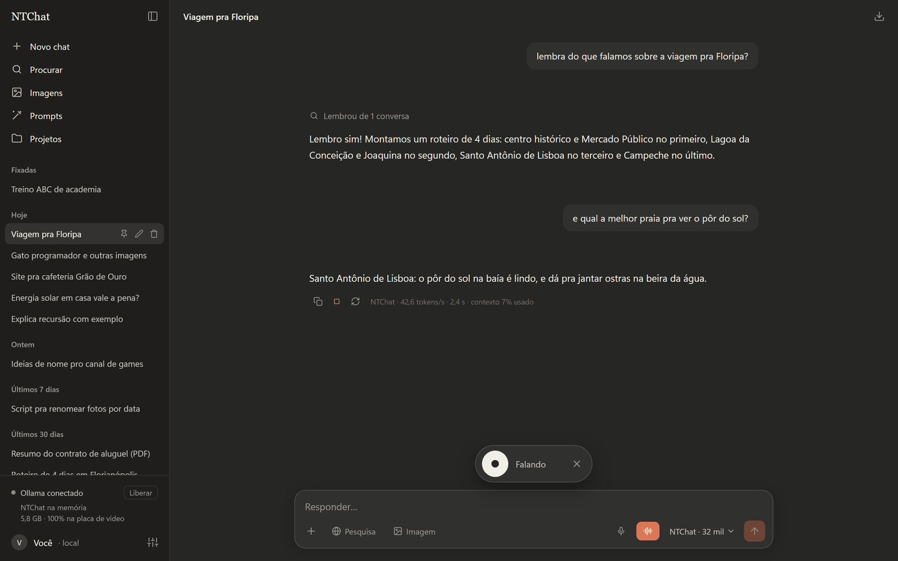

### Prompts

Em **Prompts**, na barra lateral, descreva uma cena com suas palavras e ele escreve um prompt em inglês pra usar em qualquer gerador de imagens, sem inventar coisas que você não disse.

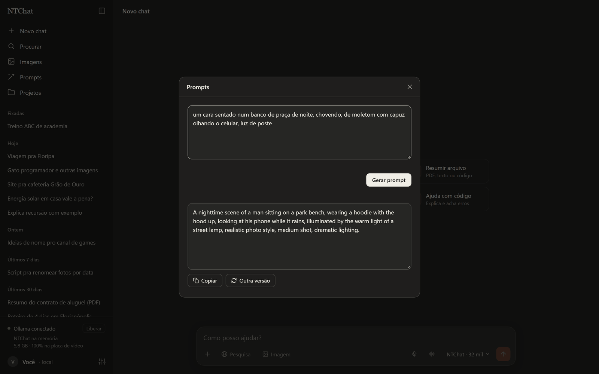

### Funciona no celular

Com o PC ligado, abra **Configurações → Usar no celular**: aparece um endereço e um código de 6 dígitos. Abra o endereço no navegador do celular (no mesmo Wi-Fi), digite o código e pronto. As conversas, a memória e os projetos são os mesmos no PC e no celular. Dá pra **Adicionar à tela inicial** pra ele abrir como um app.

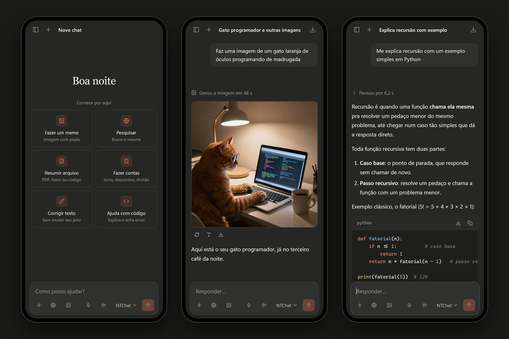

### Lembra de você

Ele guarda sozinho o que você conta sobre você (dá pra ver e apagar cada item em Configurações) e **lembra das conversas antigas**: pergunte "lembra do que falamos sobre a viagem?" e ele procura nas suas outras conversas. Você também pode escrever instruções que valem pra todas as conversas, escolher um personagem (pirata, professor paciente, narrador de futebol…) ou **criar o seu**, escrevendo do seu jeito como ele fala e se comporta, e escolher o tamanho da memória da conversa.

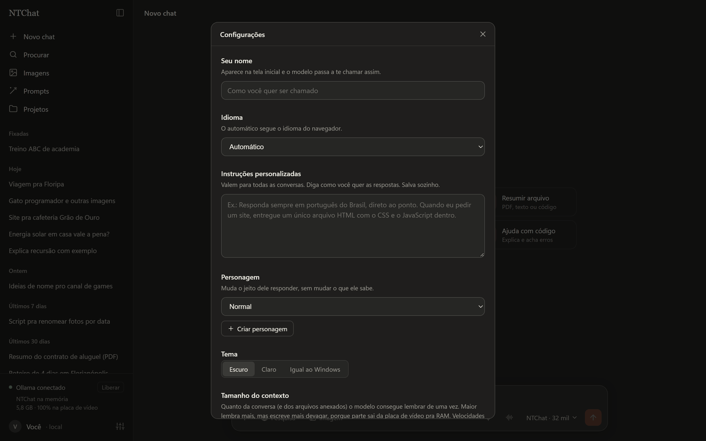

### E mais

- **Anexa imagens, PDFs e arquivos de código**: ele lê e responde sobre eles.
- **Ditado por voz**: fala que ele escreve (roda no PC, nada vai pra internet).
- **Conversas longas** não "esquecem" o começo: quando a memória enche, ele resume as mensagens antigas sozinho.
- **Contas sempre certas**: pra qualquer conta ele usa uma calculadora de verdade, em vez de fazer de cabeça.
- **Pesquisa sozinho quando precisa**: mesmo com a Pesquisa desligada, ele busca na internet quando a pergunta pede algo atual (cotação, notícia, resultado) em vez de inventar. Dá pra desligar em Configurações → Pesquisa automática.
- **Rápido pra responder**: o modelo começa a carregar enquanto você digita e fica pronto enquanto o NTChat está na tela. Uns 10 minutos depois que você sai, ele libera a placa de vídeo sozinho (ou na hora, no botão **Liberar** da barra lateral, pra jogar por exemplo).
- **Projetos**: agrupe conversas com instruções e arquivos próprios.
- Editar mensagem e mandar de novo, gerar a resposta de novo, continuar uma resposta cortada.
- Fixar, renomear, procurar e exportar conversas.
- Tema escuro, claro ou igual ao Windows.
- **Em português ou inglês**: segue o idioma do navegador, ou escolha em Configurações → Idioma.
- **Se atualiza sozinho** quando sai versão nova (veja abaixo).

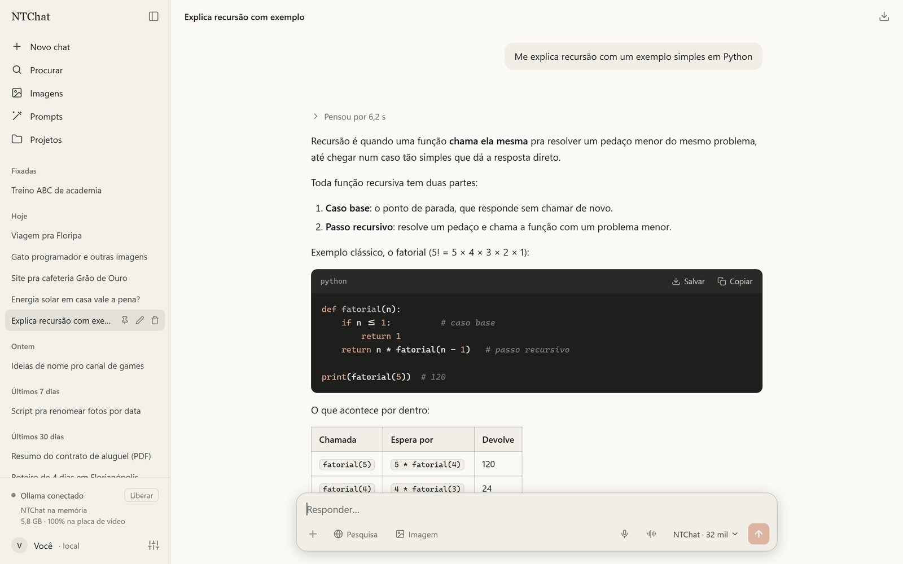

## Privacidade

- Tudo roda no seu PC: o modelo, as imagens, a voz. Suas conversas ficam na pasta `dados` do app.
- A internet só é usada quando você liga a **Pesquisa**, na instalação (pra baixar as coisas) e pra procurar atualizações no GitHub.
- O celular só conecta pela rede da sua casa, com o código de 6 dígitos. Trocar o código desconecta todos os aparelhos.

## Perguntas comuns

**Como atualizo?** Não precisa: a cada 6 horas o NTChat procura uma versão nova em [Releases](https://github.com/inflzzz/NTChat/releases). Quando acha, ele baixa e instala assim que você parar de usar por uns minutos, e a página recarrega sozinha. Suas conversas (`dados`) e sua configuração (`config.json`) não são tocadas. Em Configurações → Atualizações dá pra desligar isso ou atualizar na hora.

**Posso usar outro modelo?** Pode. Baixe qualquer modelo no Ollama (`ollama pull nome-do-modelo`) e troque o `model` no arquivo `config.json` da pasta do app. O `model_name` é o nome que aparece na tela.

**A primeira imagem demora.** É normal: na primeira vez ele carrega o gerador de imagens na placa (uns 50 segundos a 1 minuto e meio). Com **Imagem** ligado, ele já vai ligando o gerador enquanto você digita. As próximas saem bem mais rápido.

**O microfone não aparece no celular.** O navegador só libera o microfone em sites com HTTPS, e o NTChat no celular usa a rede de casa sem HTTPS. No PC funciona normalmente.

**Como desinstalo?** Apague a pasta do app e os atalhos "NTChat". Pra tirar o modelo, rode `ollama rm ntchat`. O Ollama se desinstala pelo Windows, em Aplicativos instalados.

## Aviso

O modelo padrão é **sem censura**: ele responde sobre qualquer assunto. Você é responsável pelo que pede e pelo que faz com as respostas.

## Créditos

- [Ollama](https://ollama.com) roda o modelo de texto.
- Modelo: [DeepSeek-V4-Pro-Qwen3.5-9B-UNCENSORED-heretic](https://huggingface.co/mradermacher/DeepSeek-V4-Pro-Qwen3.5-9B-UNCENSORED-heretic-i1-GGUF), em versão GGUF do mradermacher.
- [ComfyUI](https://github.com/Comfy-Org/ComfyUI) roda os modelos de imagem: [Chroma1-HD](https://huggingface.co/lodestones/Chroma1-HD), [Z-Image Turbo](https://huggingface.co/Comfy-Org/z_image_turbo) , [Stable Diffusion 1.5](https://huggingface.co/stable-diffusion-v1-5/stable-diffusion-v1-5) com [LCM-LoRA](https://huggingface.co/latent-consistency/lcm-lora-sdv1-5) e [FLUX.2 klein 4B](https://huggingface.co/black-forest-labs/FLUX.2-klein-4b-fp8) (Black Forest Labs, Apache 2.0). [Real-ESRGAN](https://github.com/xinntao/Real-ESRGAN) faz a versão 2K.
- [faster-whisper](https://github.com/SYSTRAN/faster-whisper) faz o ditado por voz, [Kokoro](https://huggingface.co/hexgrad/Kokoro-82M) (Apache 2.0, via [kokoro-onnx](https://github.com/thewh1teagle/kokoro-onnx)) é a voz e [rembg](https://github.com/danielgatis/rembg) recorta as figurinhas.
- Na pasta `lib`: [marked](https://github.com/markedjs/marked) (MIT), [highlight.js](https://github.com/highlightjs/highlight.js) (BSD-3), [DOMPurify](https://github.com/cure53/DOMPurify) (Apache 2.0 / MPL 2.0) e [pdf.js](https://github.com/mozilla/pdf.js) (Apache 2.0).

Cada modelo tem a própria licença; confira na página de cada um antes de usar comercialmente.

## Licença

[MIT](LICENSE)
